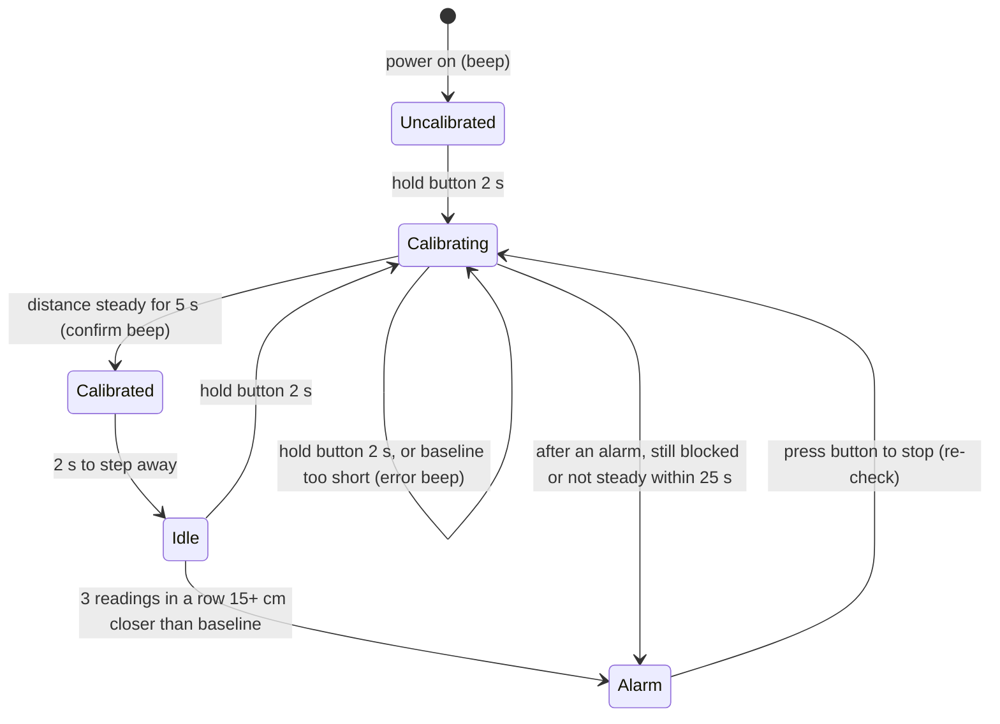

# DoorGym

An Arduino-based alarm that plays a melody on a buzzer when something moves
into the doorway, such as the door opening or someone walking through.

## How it works

An ultrasonic sensor measures the distance to whatever is in front of it. You
calibrate it once with the doorway clear, and from then on it raises the alarm
when something comes noticeably closer than that distance.



- **Calibrating**: keep the doorway clear. The distance must stay within
  ±10 cm for 5 s; the average becomes the baseline. Holding the button 2 s
  always starts a fresh calibration and sets the *reference* distance.
- **Idle**: armed. Readings with no echo are ignored.
- **Alarm**: a melody plays until you press the button. The device then
  re-checks the doorway: it only re-arms once the distance is back near the
  reference, so a door left open can't be accepted as the new normal.

## Hardware

| Part | Pin | Notes |
|---|---|---|
| Arduino Uno | | |
| HC-SR04 ultrasonic sensor | trig → D4, echo → D5 | VCC to 5 V, GND to GND |
| Push button | D3 | other leg to GND (uses the internal pull-up) |
| Passive buzzer | D2 | other leg to GND; must be passive, as the melody uses `tone()` |

Pins are defined in `src/IoMap.hpp`. Point the sensor across the doorway so that
an opening door or a person passing comes between it and the far side.

## Build and upload

Install [PlatformIO Core](https://platformio.org/install/cli), connect the Uno,
then run these commands from the project directory:

```sh
pio run
pio run --target upload
```
